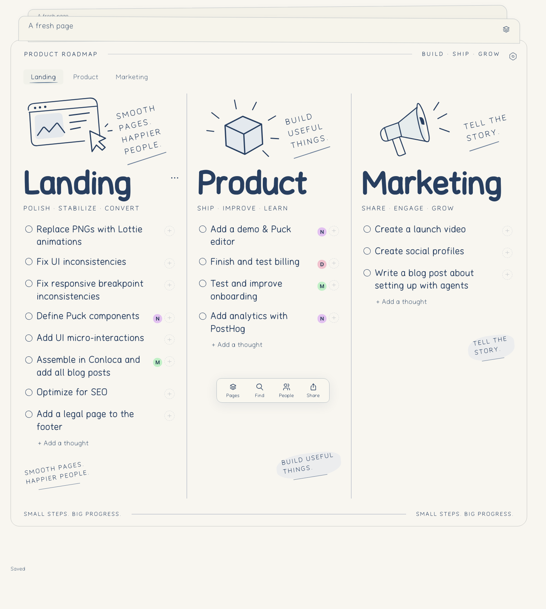
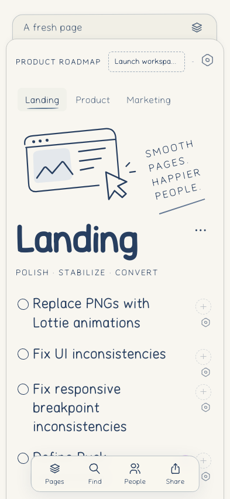
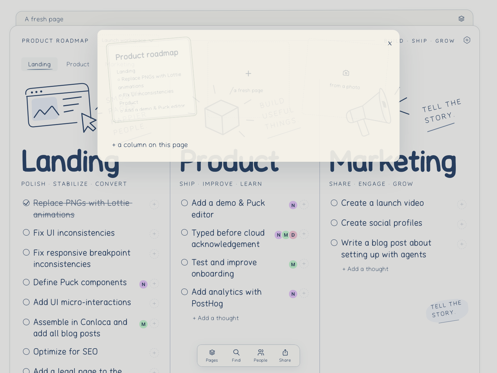

# Boards

**[Open the notebook](https://boards-app-gamma.vercel.app/)** · **[Conloca Sans specimen](https://boards-app-gamma.vercel.app/type.html)**

Paper-like editable pages, hosted on Vercel with the isolated `boards_prototype` Neon database. [The public build manifest](https://boards-app-gamma.vercel.app/build.json) identifies the deployed asset generation; a source commit alone does not prove that its deployment is live. [Earlier unmocked cloud smoke](docs/LIVE-SMOKE-2026-09-13.md).

**Earlier live checkpoint, 2026-09-15:** browser build `3dfae8a87229ebf6`. [Verified public release](docs/LIVE-RELEASE-2026-09-15.md) · [Every requested feature and what remains](docs/REQUEST-CHECKLIST-2026-09-15.md).

## Current public release — 16 September

Build **`f121ea23096d236d`** now supports separate cloud-space creation/switching and an editable photo-draft workspace with private browser recovery. Automatic photo recognition and the installed Slack app are **not active**. [Exact shipped scope, live tests and screenshots](docs/PHOTO-SPACES-2026-09-16.md). Source is pushed to [Forgejo PR #8](https://git.hyperide.ai/ultrabricks/boards-app/pulls/8); pending remote CI is not represented as a completed main merge.

## Previous public update

Current public build: **`00c85bc1b7ef1a22`**. The unexplained Slack file import is removed. Board, type and shared pages carry noindex directives while read-only cards remain publicly fetchable. Corporate login, spaces, profiles, item history and mail have a separate tested local implementation but are **not activated in production**. [Exact readiness, tests and blockers](docs/ACCOUNTS-RELEASE-GATES.md).

Previous stack/preview release:

Build `634694f79261ec34`: neighboring sheets now sit behind the active paper, duplicate fresh-page placeholders are removed, and shared URLs now have server-generated current-state metadata and PNG previews. [Release details, screenshots and verification](docs/STACK-AND-PREVIEWS-2026-09-15.md).

## Current prototype work

Public app-shell service worker with stale-while-revalidate, one bundled application entry and background font construction. A new sample page paints before cloud acknowledgement; a returning editing tab can restore its own snapshot while revalidating the version. Cloud failures and conflicts remain explicit. Unsaved drafts do not expire with the clean read cache.

Multi-assignee selection stays open for changes, overlapping portraits rise on hover/focus, missing photos use initials on distinct colors. A person's task list is labeled: up to five rows stay expanded; six or more show three with expansion. Column navigation follows position, paper layers open an animated board shelf, and the last bottom action is Share. Completion draws a restrained irregular stroke and supports an optional pencil sound.



<details><summary>Mobile and paper shelf</summary>



</details>

The desktop and mobile screenshots were taken on the actual public service in an isolated test notebook, using real Neon requests. The paper-shelf screenshot is from a separately labeled fixture run. No private user key or real team portraits are published. [Chromium report](docs/metrics/prototype-ui-chromium.json), [WebKit report](docs/metrics/prototype-ui-webkit.json), [asset budgets](docs/metrics/prototype-budget.json). WebKit's fixture suite blocks service workers; SW behavior has separate tests.

## Run and verify with Bun

```sh
cd apps/prototype
bun install --frozen-lockfile
bun run build
bun serve.ts
```

The local shell is at `http://127.0.0.1:5183`; normal operation uses the configured cloud. `bun run test` runs unit regressions. Native fixture checks require Playwright browsers and the local server: `bunx --bun playwright install chromium webkit`, then `bun check-stage.ts chromium` and `bun check-stage.ts webkit`. Each stage records its real exit code and log separately.

The prototype has a dedicated frozen Bun lockfile, Oxc/Oxfmt checks, unit and native-browser CI, axe checks and compressed asset budgets. The fuller Bun/Oxc/Nx migration is still in [PR #2](https://github.com/ultrabricks/boards-app/pull/2); prototype tests do not establish whole-application 80% coverage or completion of that migration.

## Using and protecting your pages

Bookmark the address after creating a page. The `#key=…` fragment is the editing capability; keep it private. Share creates a separately revocable read-only link. This prototype does not have production sign-in or account recovery. Clean and unsaved editing snapshots remain in the current tab's sessionStorage, not service-worker caches or an external analytics service. Closing the tab may remove that recovery copy; export important drafts.

Only public shell resources enter CacheStorage. Auth, task APIs, portraits and shared documents never do. Failed storage writes are reported, version conflicts block destructive replacement, and readonly shares are fetched again instead of restored as private editing snapshots. Link revocation cannot delete screenshots recipients already retained.

**Page options → Loading measurements**, or `window.boardsMetrics()`, exposes local loading, paint, interaction and resource timing without task text, names, URLs with keys, or tokens. These local measurements and CI budgets are not production field percentiles.

Slack portrait import tooling is in `apps/prototype/slack-export.ts`. It exports bounded thumbnails and names, not tokens or emails; the private output belongs outside Git and can be imported through People. Existing records do not gain unverified account ownership. Real Slack photos are not bundled into the public default page or screenshots.

Tabler's MIT icons are converted at build time through RoughJS (MIT); neither the full icon library nor an animation player ships to the browser. Page animation uses actual editable DOM and honors reduced motion. The independent font page builds its original variable typeface locally; font binaries are not shipped as repository attachments.

## Plan and recovery

[Interruption analysis and recovery improvements](docs/INTERRUPTIONS-2026-09-15.md): observed causes, evidence, restart rules and the latest account-save regression.


[Roadmap](ROADMAP.md) · [Execution failure analysis](docs/PROCESS.md) · [Persisted user rules](docs/USER_RULES.json) · [Agent entry point](AGENTS.md) · [Prototype polish #5](https://github.com/ultrabricks/boards-app/issues/5) · [Full-product gaps #6](https://github.com/ultrabricks/boards-app/issues/6)

Real OAuth/linking, email, authenticated provider integrations, semantic matching, generated artwork, photo transcription remain unfinished full-product gates. Server-generated share cards are now live; client-side unfurl caching remains controlled by recipients. The original `scriptboard` team database is not replaced by this prototype. The prototype is bounded to 200 notebooks, 50 shares per notebook and a 512 KB document; it is not an audited multi-tenant identity platform.
