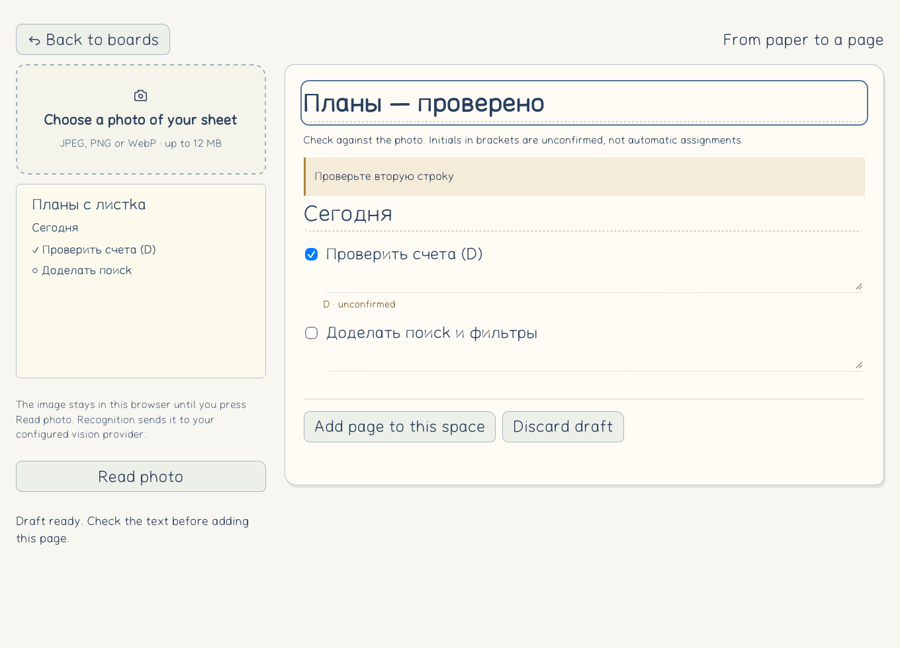
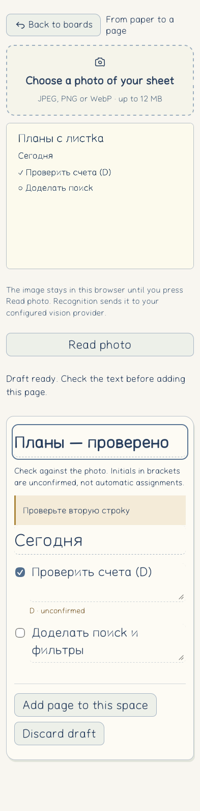

# Photo drafts and cloud-space switching — 16 September 2026

## Implemented scope, not an activation claim
The new board entry points are the space name in the paper caption and Pages → from a photo. Spaces are separate capability-backed cloud documents, remembered in the current browser tab. This is not account-wide membership discovery or cross-device sign-in. Existing editing capabilities are preserved.
The photo workspace accepts file selection, drop and paste, displays the original beside an editable sheet, preserves completion marks and leaves assignee initials unconfirmed. Text can be entered manually while recognition is unavailable. A page is not added until the draft is confirmed. Draft image and text remain private browser storage, not public service-worker cache.

## Review findings reproduced and fixed
- After a lost creation response, changing the requested space name could still create the old name. Retries now retain the same capability and apply a version-checked rename to the returned space, preserving its boards.
- Opening the photo editor twice could race while waiting for the previous save. Entry is guarded until that editor exits.
- Adding the space switcher hid a board's existing tagline. Both now remain visible.
- Typing rewrote the whole image and reopened IndexedDB per keystroke. Image and draft text are separate records, one repository connection is used per screen, and a latest-only writer coalesces pending text writes. Thirty simultaneous input edits produce no new image writes or database opens.
- A selected replacement photo and its empty draft are persisted in one transaction. Exiting after a failed persistence is not reported as successful recovery.

## Verification and limits
Native Chromium and WebKit use real image decoding and IndexedDB. Their photo/space tests use explicit fixture cloud and model responses, not a real model. The tests cover double entry, unavailable provider, draft recovery, input-write volume, four viewport widths, confirmed-only saving, changed-name retry and independent spaces. Unit, Oxc, format and dedicated strict photo TypeScript checks are separate gates. Public live verification is recorded below only after execution.

Automatic recognition is not activated. The project OIDC credential authenticated to Vercel, but the minimal model probe returned HTTP 403 requiring AI Gateway activation; no card, credits purchase or paid upgrade was performed. The recognition endpoint write was explicitly tool-blocked and was not recreated via another channel. The provider adapter is source preparation, not an available server endpoint. Photos are not uploaded when the status endpoint is unavailable.

Slack remains a different blocked integration. The actual app-management page still asks the user to sign in. A ChatGPT Slack connector is not the Boards application's OAuth installation or token. The signed-in board, corporate-domain policy, account database, mail worker and production Slack activation remain listed in ACCOUNTS-RELEASE-GATES.md.

## Published result
Public build **`f121ea23096d236d`** is on https://boards-app-gamma.vercel.app/ . Deployment `dpl_GiYWbbhyPcjYeGMkop8X18Tghxxf` was promoted from `boards-a4385efjh-inventorems-projects.vercel.app` after staged HTTP/readback and the reviewed fixes. Source through `db69eb7b977ae5d7d2496895f484a3142c7fbf56` is pushed to Forgejo PR #8. Its remote CI checks are still pending; main has not been merged.

Unmocked public tests created a separate cloud space, saved a manually entered draft page, read the saved text in an independent browser context and switched back to the first space with its original 15 tasks intact. Five new live checks passed with zero photo uploads and no JavaScript errors. A further ten-check public smoke suite passed cloud save/read, sharing/revocation, offline recovery and read-only inspection of the supplied user's board. Agent-browser separately confirmed that same board has 15 tasks, Saved, the new space menu and the photo entry; no user-board writes were made.

Current local evidence: 270 unit tests / 3,002 assertions, lint and strict photo types. Eight photo/space checks pass in each of Chromium and WebKit, with explicit fixture vision responses and real native storage/image decoding. Public board+type browser assets are 68,630 bytes gzip. These counts do not establish the requested whole-product 2,000 tests or 80% coverage.

The photo editor now distinguishes a successful cloud save from a failed local-draft cleanup. If cleanup fails, it exits with an accurate saved notice rather than suggesting that the page was not saved. Opening a photo draft requires a connected target space; missing/paused queue handling is already enforced by the existing flush contract.

For an old service-worker tab, a current-build query parameter before the existing fragment opens current HTML without clearing browser drafts. Never publish the editing capability in README or reports. This is not a claim that the automatic worker-update experiment is deployed.
