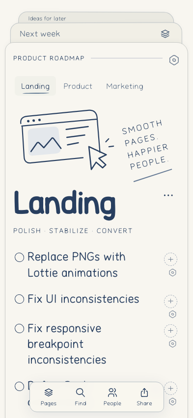
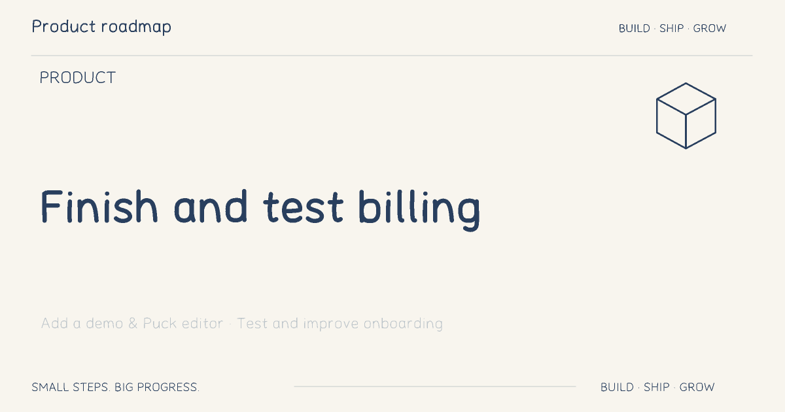

# Paper depth and live share previews

Verified public service: https://boards-app-gamma.vercel.app/
Browser build: `634694f79261ec34`. Production deployment: `dpl_XKtn6r7ZBXeEcNYKM9vEx4knd3nQ` (`boards-qfktpjr5k-inventorems-projects.vercel.app`).

## Paper stack
The active paper is now an opaque foreground surface. Neighboring sheets are separate siblings behind it, and their decorative bodies continue underneath the active sheet. Only their exposed strip receives clicks, so clicking the main page cannot activate a hidden sheet.
With no other pages, exactly one “A fresh page” sheet is shown. With one other page, only that real title is shown. With two or more, the two nearest real titles are shown; no invented fresh-page filler is added. A single read-only shared page has no misleading creation affordance.
The page picker marks the current board, updates aria-expanded and restores focus on close. A WebKit-specific pointer/focus regression was fixed. The distant sheet's contrast was increased after axe detected a 4.48:1 failure.

## New live capability: dynamic share cards
Share now creates `/s/<read-token>` URLs with server-rendered Open Graph metadata and a deterministic 1200×630 PNG. Board, column, single-item, selected-item and space scopes use the existing projection-aware renderer. Item cards contain the board and column title, a fitted readable task and optional faded neighbors; workspace names and unselected private contents do not enter metadata.
The renderer runs on Bun, without an LLM or external font files. HTML and PNG are read from the current authorized shared projection, not an old generated snapshot. Revocation is checked on every request and both endpoints return 404 afterward. Responses use no-store; recipient applications can still keep their own copies after receiving a preview.
Older `#share=...` links remain readable. Copy a new link with Share to receive the crawler-readable URL format. No messages were sent to external workspaces to test unfurling; the actual public HTML metadata and PNG endpoints were tested directly.

## Evidence
Native Chromium and WebKit tested 1/2/3/6-page stacks at widths 320, 393, 640, 768, 1024, 1448 and 1920. Assertions check hit testing at the overlap, opaque foreground paint, one placeholder, keyboard reopening and no horizontal overflow. Initial tests reproduced three failing placeholder cases before the fix.
The full prototype UI suites (15 Chromium and 14 WebKit groups) and nine loading-recovery scenarios per engine pass. Unit suite now has 149 cases; this is not a whole-product 2000-case/80%-coverage claim.
Unmocked public tests created isolated notebooks, verified all five preview scopes, verified a saved edit changes both HTML metadata and PNG, then revoked every test share and observed 404 for HTML and image. The existing live smoke also passed save/independent read, offline/retry and the supplied user's notebook read without writes. Agent-browser confirmed 15 user tasks, Saved, current build and exactly one fresh sheet.

Source integration is still pending: the code is preserved/staged on the Mac, but the configured independent review backend timed out again and the commit gate has not been bypassed. This deployment and its tests are real; a merged source release is a separate outstanding gate.
